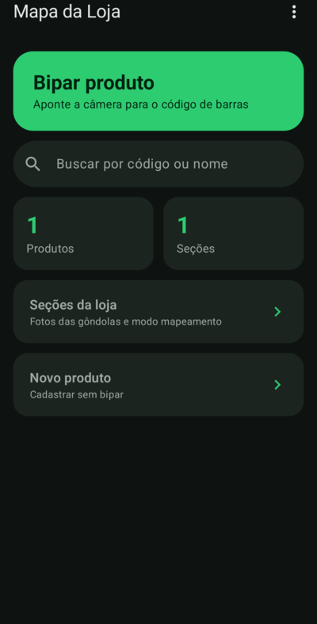

# Mapa da Loja

App Android para **achar onde cada produto fica numa loja** (farmácia, mercado,
loja de conveniência…). Você bipa o código de barras, ou digita o código ou o nome,
e o app mostra a **seção**, a **prateleira** e o **ponto exato na foto da gôndola**.

Foi feito para agilizar a troca de etiquetas e de promoções. Assim ninguém fica
rodando a loja procurando um produto.



## Funcionalidades

- 📷 **Leitor de código de barras** (EAN-13, EAN-8, UPC, Code 128, Code 39, ITF, QR)
- 🔎 **Busca** por código de barras, código interno ou nome
- 🗺️ **Seções com foto**: cada gôndola tem uma foto, e cada produto tem um marcador nela
- ⚡ **Modo mapeamento**: escolha a prateleira e vá bipando os produtos um atrás do outro
- 💾 **Backup e restauração** em `.zip` (dados + fotos)
- 📴 **Funciona sem internet**: tudo fica salvo no próprio celular
- 🌙 Tema escuro

## Instalar

Baixe o APK na página de *Releases*, ou gere o seu (veja abaixo). Mande o arquivo para
o celular e abra. O Android vai pedir para permitir "instalar apps desconhecidos".

Na primeira vez que for bipar, o celular precisa de internet para o Google Play
Services baixar o leitor de código de barras.

## Como usar

1. **Seções da loja → Nova seção**: dê um nome, diga onde fica e tire a foto da gôndola.
2. Dentro da seção, escolha a **prateleira** (1 = a mais alta) e toque em **Bipar produtos**.
3. Para marcar o ponto exato, toque no produto na lista e depois toque na foto.
4. No dia a dia, use **Bipar produto** na tela inicial para ver onde o produto está.
5. Faça **backup** com frequência: menu ⋮ → *Salvar backup*.

## Compilar

Requisitos: **JDK 17 ou 21** e **Android SDK** (plataforma 35). O Android Studio já traz os dois.

```bash
./compilar.sh                # ou: ./gradlew assembleDebug
adb install -r app/build/outputs/apk/debug/app-debug.apk
```

Para gerar dados de teste (uma seção com foto e um produto com código de barras):

```bash
python3 tools/gerar_dados_teste.py saida/
```

## Organização do código

O projeto é dividido em módulos Gradle:

| Módulo             | O que tem                                                         |
|--------------------|-------------------------------------------------------------------|
| `app`              | `MainActivity` e a navegação que junta as telas                   |
| `core:data`        | Banco de dados (Room), fotos e backup                             |
| `core:ui`          | Tema, componentes reutilizáveis, leitor de código, rotas de navegação |
| `feature:busca`    | Tela inicial e busca                                              |
| `feature:produto`  | Tela "Onde está" e cadastro de produto                            |
| `feature:secao`    | Lista de seções, modo mapeamento e cadastro de seção              |
| `build-logic`      | Configuração de Gradle compartilhada entre os módulos             |

Os módulos `feature:*` só dependem dos módulos `core:*`, nunca uns dos outros.
Para abrir a tela de outro módulo, eles usam os endereços em
[`Rotas`](core/ui/src/main/java/com/renan/mapaloja/core/ui/navegacao/Rotas.kt).
As versões das bibliotecas ficam em [`gradle/libs.versions.toml`](gradle/libs.versions.toml).

Tecnologias: Kotlin, Jetpack Compose (Material 3), Room, Navigation Compose
e Google Code Scanner (ML Kit).

## Privacidade

O app não tem servidor, conta nem rastreamento. Os dados e as fotos ficam só no
celular, até você mesmo exportar um backup. **Não publique backups**: eles podem
conter fotos e informações internas da loja.

## Licença

Copyright (C) 2026 Renan2010p

Este programa é software livre: você pode redistribuí-lo e/ou modificá-lo sob os
termos da **GNU General Public License**, conforme publicada pela Free Software
Foundation, na **versão 3** da Licença ou (a seu critério) qualquer versão posterior.

Este programa é distribuído na esperança de que seja útil, mas **SEM QUALQUER
GARANTIA**, nem mesmo a garantia implícita de COMERCIALIZAÇÃO ou de ADEQUAÇÃO A UM
PROPÓSITO ESPECÍFICO. Veja o arquivo [LICENSE](LICENSE) para mais detalhes.

> Este é um projeto independente. Ele não é oficial nem tem ligação com nenhuma
> rede de farmácias ou varejista.
